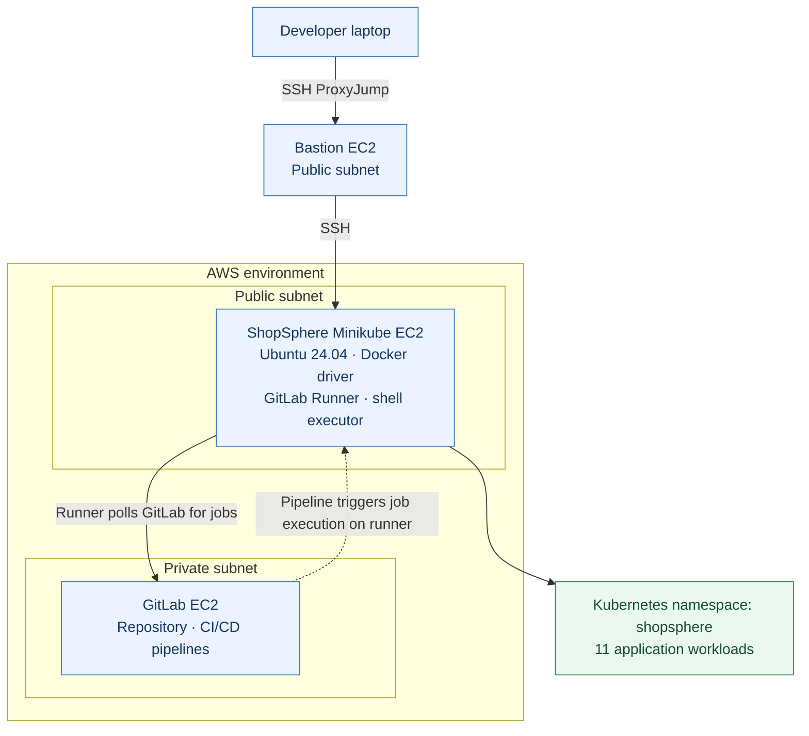
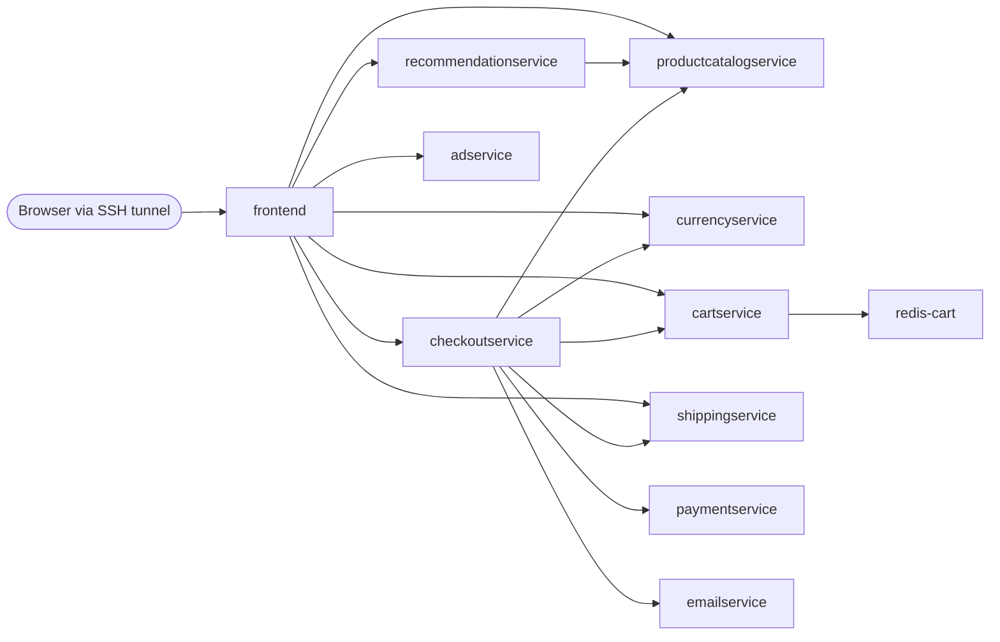

# ShopSphere

A hands-on Kubernetes project: Google's **Online Boutique** (11 microservices) running on **Minikube on an AWS EC2 instance**, with hand-written manifests, per-service RBAC, default-deny NetworkPolicies, a **GitLab CI/CD** pipeline that validates and deploys from git, and **Prometheus and Grafana** monitoring with alert rules.

The goal was not just to get the demo running, but to write every manifest myself, break things on purpose, and document what I learned.

> The application itself is [GoogleCloudPlatform/microservices-demo](https://github.com/GoogleCloudPlatform/microservices-demo) (Apache 2.0), image version `v0.10.7`. The original release manifest is kept unchanged in `upstream/` for reference. The manifests in `k8s/`, the CI identity in `bootstrap/` and `.gitlab-ci.yml` were written for this project, using the upstream configuration (images, ports, environment variables) as the reference.

> This project runs inside the AWS lab built in [devops-lab-infra](https://github.com/Aakash17-hub/devops-lab-infra) (VPC, bastion, private-subnet GitLab).

> The same application is also deployed to Amazon EKS, with a Jenkins pipeline and automatic rollback, in [boutique-eks](https://github.com/Aakash17-hub/boutique-eks).

---

## Tech stack

| Area | Tools |
|---|---|
| Orchestration | Kubernetes (Minikube, Docker driver), kubectl, metrics-server (`kubectl top`) |
| Workload configuration | Hand-written YAML manifests, labels, readiness and liveness probes (gRPC, HTTP, TCP), resource requests and limits |
| Security | RBAC (per-service ServiceAccounts, read-only Role, least-privilege CI identity), NetworkPolicies (default-deny ingress plus allow rules) |
| CI/CD | GitLab CI (shell runner), server-side dry-run validation, `kubectl rollout status` |
| Monitoring | Prometheus, Grafana and kube-state-metrics (`kube-prometheus-stack` via Helm), PrometheusRule alerts, PromQL |
| Network testing | kindnet (default CNI), Calico (separate test profile), `nc`, `curl`, `kubectl port-forward` |
| Cloud | AWS EC2, VPC, security groups, bastion host (SSH ProxyJump) |
| OS and runtime | Ubuntu 24.04, Docker |
| Source control | Self-hosted GitLab, GitHub |
| Application | Google Online Boutique v0.10.7 (11 microservices and Redis) |

---

## Architecture



- The Minikube host has its own security group. Inbound is **SSH only, from the bastion's security group**. Nothing else is exposed.
- The frontend Service is `ClusterIP`. I reach it with `kubectl port-forward` through an SSH tunnel, so there is no public load balancer.
- The Minikube host sits in a public subnet so it can pull images without a NAT gateway (a NAT gateway is the most expensive idle resource in this setup).
- Host: Ubuntu 24.04 on `m7i-flex.large` (2 vCPU, 8 GiB), 40 GB gp3, 4 GB swap. Minikube runs with `--driver=docker --cpus=2 --memory=6144`.

### Service call graph



### Ports

| Service | Container port | Service port |
|---|---|---|
| frontend | 8080 | 80 |
| productcatalogservice | 3550 | 3550 |
| currencyservice | 7000 | 7000 |
| cartservice | 7070 | 7070 |
| shippingservice | 50051 | 50051 |
| paymentservice | 50051 | 50051 |
| emailservice | **8080** | **5000** |
| recommendationservice | 8080 | 8080 |
| checkoutservice | 5050 | 5050 |
| adservice | 9555 | 9555 |
| redis-cart | 6379 | 6379 |

The load generator from the upstream demo is intentionally not deployed (the node only has 2 vCPUs).

---

## Repository layout

```
.
├── upstream/                 # original Online Boutique release manifest (unchanged)
├── k8s/                      # my manifests, applied by CI
│   ├── 00-namespace.yaml
│   ├── 01-rbac.yaml          # ServiceAccounts, read-only Role
│   ├── 02-networkpolicies.yaml
│   └── <service>.yaml        # one Deployment + Service per service (11 files)
├── bootstrap/
│   └── ci-deployer.yaml      # least-privilege identity for CI (applied by hand, NOT by CI)
├── monitoring/               # Helm values and alert rules (applied by hand, NOT by CI)
│   ├── monitoring-values.yaml
│   └── shopsphere-alerts.yaml
├── docs/                     # screenshots and notes
└── .gitlab-ci.yml
```

---

## What is implemented

### 1. Manifests (`k8s/`)

- One namespace, `shopsphere`. Every object carries `app` and `app.kubernetes.io/part-of` labels.
- **Probes** on every workload: gRPC probes for the gRPC services, an HTTP probe on `/_healthz` for the frontend, and a TCP readiness plus `redis-cli ping` liveness probe for Redis.
- **Requests and limits** chosen from real usage (`kubectl top`), not copied blindly:

| Workload | CPU request / limit | Memory request / limit |
|---|---|---|
| most gRPC services (currency, productcatalog, shipping, payment, email, checkout) | 20m / 200m | 32Mi / 128Mi |
| cartservice | 30m / 200m | 48Mi / 128Mi |
| frontend | 20m / 200m | 64Mi / 128Mi |
| recommendationservice | 30m / 200m | 128Mi / 450Mi |
| adservice (JVM, slower start) | 20m / 300m | 128Mi / 300Mi |
| redis-cart | 20m / 100m | 32Mi / 128Mi |

### 2. RBAC

- Every service has its **own ServiceAccount** with `automountServiceAccountToken: false`. None of these services talks to the Kubernetes API, so no token is mounted into the pods.
- `ops-viewer`: a namespaced, read-only Role (get/list/watch on pods, pod logs, services, deployments) with a RoleBinding. It cannot delete anything or read secrets.

### 3. NetworkPolicies

- default-deny-ingress applies to pods across the namespace. The file defines 11 destination-specific allow policies: 10 service-to-service rules and one frontend ingress rule. The frontend rule allows traffic to pod port 8080 without a source-selector restriction.
- Rules use container ports, not Service ports (this matters for emailservice).
- Ingress is restricted by policy rules; egress is not restricted yet (see Limitations).
- Enforcement was verified on the original Minikube profile (default `kindnet` CNI, image `kindest/kindnetd:v20260820-69b56db7`). In a throwaway namespace, a deny-all policy turned a working request into a timeout. In `shopsphere`, a test pod without a permitted label could not reach `paymentservice`, while a pod labelled `app=checkoutservice` could. This covers the tested paths only, not every rule or egress behaviour.
- Additional test: on a separate `netpol-test` Minikube profile using Calico, three permitted connections succeeded and three denied connections timed out (details under Verification). This is independent of the `kindnet` result above.

### 4. CI/CD (GitLab CI)

A shell runner on the Minikube host runs two stages:

| Stage | What it does | When |
|---|---|---|
| `validate` | `kubectl apply --dry-run=server` on all manifests | every push |
| `deploy` | `kubectl apply`, then `kubectl rollout status` for every deployment | `main` branch only |

The pipeline does **not** use an admin kubeconfig. It uses a dedicated `ci-deployer` ServiceAccount whose Role can create/update/patch deployments, services, service accounts and network policies in `shopsphere`, and nothing else. It cannot delete, cannot read secrets, cannot touch RBAC objects and cannot reach other namespaces. For that reason the pipeline skips `00-namespace.yaml` and `01-rbac.yaml`; those are applied by an admin.

**Demo:** changing `replicas: 1` to `replicas: 2` in `k8s/frontend.yaml` and pushing created a second frontend pod with no manual `kubectl apply`. Pushing `replicas: 1` scaled it back. Rollback is a git commit.

### CI/CD evidence

The screenshots below are historical examples from pipeline #12, showing the validation and frontend scale-up demonstration. They are not screenshots of the latest pipeline.


*Historical pipeline list: pipelines #9–#11 failed due to the YAML parsing issue documented below; #12 and #13 passed at the time of capture.*


*Historical validation job: server-side dry run reports the planned frontend change.*


*Historical deploy job: the frontend rollout waits for the second replica and succeeds.*

**Latest recorded verification:** commit `cbac4b1` (`docs: improve NetworkPolicy verification and setup guide`) passed the GitLab validation and deployment stages. The deploy job applied the manifests and all 11 application deployments rolled out successfully.

### 5. Monitoring (Prometheus and Grafana)

Prometheus and Grafana run in a separate `monitoring` namespace, installed from the `kube-prometheus-stack` Helm chart (version `92.17.0`). The Helm values are in `monitoring/monitoring-values.yaml` and the alert rules in `monitoring/shopsphere-alerts.yaml`. Both are applied by hand, not by CI.

- **Installed:** Prometheus, Grafana, the Prometheus Operator and kube-state-metrics.
- **Left out to save memory on the 8 GiB node:** Alertmanager, node-exporter and the scrape targets for etcd, scheduler, controller-manager and kube-proxy.
- **Limits:** Prometheus keeps 2 days of data, and Prometheus and Grafana both have resource requests and limits.
- **Metrics used:** the dashboards use cluster metrics (cAdvisor and kube-state-metrics). No application-level metrics are collected.
- **Access:** Grafana is reached the same way as the shop: `kubectl port-forward` plus an SSH tunnel, at `http://localhost:3000`. There is no public endpoint.


*The monitoring stack is running in the `monitoring` namespace, and the `shopsphere-alerts` rule object is loaded.*


*Baseline: the built-in `Kubernetes / Compute Resources / Namespace (Pods)` dashboard for `shopsphere`. Memory is about 94% of requests but 29% of limits, because requests were set close to measured usage.*

**Alert rules**

| Alert | Fires when | For | Severity |
|---|---|---|---|
| `ShopSpherePodCrashLooping` | a `shopsphere` container was in `CrashLoopBackOff` at any point in the last 2 minutes | 1 min | critical |
| `ShopSpherePodNotReady` | a `shopsphere` pod's Ready condition is false | 2 min | warning |

Alertmanager is disabled, so the rule states are visible in Grafana's alert list but no notification is sent.


*Both rules in the Normal state before the tests.*

**Failure tests**

I broke `cartservice` on purpose twice and checked what the monitoring showed. After each test I restored the Deployment with `kubectl apply -f k8s/cartservice.yaml` and confirmed that `kubectl diff` was empty.

*Test 1: memory limit too low.* I set a memory request of 8Mi and a limit of 10Mi on `cartservice`. The new pod was `OOMKilled` (exit code 137) and went into `CrashLoopBackOff`. The old pod stayed `1/1 Running`, because the new one never became Ready, so the shop kept working. Both alerts fired and the restart counter kept climbing.


*The new pod is in `CrashLoopBackOff` with `OOMKilled` and exit code 137, while the old pod keeps running.*


*Both alert rules firing.*


*The restart counter of the new pod climbing (`kube_pod_container_status_restarts_total` in Grafana Explore); the old pod stays at 0.*

*Test 2: wrong Redis address.* I set `REDIS_ADDR=wrong-redis:6379` on `cartservice`. The rollout completed and the pod was `1/1 Running` with 0 restarts. A request to `/cart` returned HTTP 500, and the frontend log showed `UnableToConnect on wrong-redis:6379` after the Redis client timed out (5000 ms). Neither alert fired.


*`cartservice` is `1/1 Running`, yet `/cart` returns HTTP 500 and the log shows `UnableToConnect`.*


*Taken while the wrong address was live: both rules are still Normal.*

| Failure | Pod status | Alerts | Caught? |
|---|---|---|---|
| Memory limit too low (10Mi) | `OOMKilled`, then `CrashLoopBackOff` | both fired | Yes |
| Wrong Redis address | `1/1 Running`, 0 restarts | none | No |

The pod-level alerts catch crashes and pods that are not Ready, but not a broken dependency behind a pod that looks healthy. Catching the second case needs a check on what users see, for example a synthetic probe of `/cart`, or a dependency-aware readiness probe (both are on the roadmap).

---

## Verification

| Check | Evidence / command | Result |
|---|---|---|
| Application health | `kubectl get pods -n shopsphere` on the original `minikube` profile | All 11 application pods were `1/1 Running` in the latest health check; historical synchronized restarts were observed and the exact root cause was not confirmed |
| Deployment rollout | `kubectl rollout status` for each deployment | All 11 deployments successfully rolled out |
| Frontend HTTP response | `curl -I http://127.0.0.1:8080` while forwarding `svc/frontend` port 80 to local port 8080 | `HTTP/1.1 200 OK` |
| End to end | Add an item to the cart and place a test order through the browser | Successfully completed in the latest smoke test; order flow reached completion |
| `ops-viewer` rights | `kubectl auth can-i list pods -n shopsphere --as=system:serviceaccount:shopsphere:ops-viewer` | `yes` (previously tested) |
| `ops-viewer` limits | Same check with `delete pods`, `get secrets`, or namespace `default` | `no` (previously tested) |
| `ci-deployer` rights and limits | `kubectl auth can-i` checks using its kubeconfig | Previously tested; the pipeline also successfully completed validate and deploy stages |
| NetworkPolicy enforcement | Deny-all test in a throwaway namespace, then `nc -w 3 paymentservice 50051` from an unlabelled pod and from a pod labelled `app=checkoutservice` in `shopsphere` (original profile, `kindnet` CNI) | Deny-all caused a timeout; the unlabelled pod failed (`exit=1`), the labelled pod succeeded (`exit=0`) |
| Monitoring stack | `kubectl get pods -n monitoring`, Grafana dashboards and alert rules | Prometheus, Grafana, the operator and kube-state-metrics `Running`; both alert rules loaded (section 5) |
| Alert test: OOM / CrashLoop | `cartservice` with a 10Mi memory limit | `OOMKilled`, `CrashLoopBackOff`; both alerts fired |
| Alert test: wrong Redis address | `REDIS_ADDR=wrong-redis:6379` on `cartservice` | Pod stayed `1/1 Running`, `/cart` returned HTTP 500, no alert fired |

### Additional NetworkPolicy test (separate Calico profile)

A second Minikube profile, `netpol-test`, was created with the Calico CNI for an additional check. It is separate from the main `kindnet` cluster. The Calico version was not recorded. The temporary test pods were deleted afterwards and the profile was stopped.

| Destination | Permitted test pod | Denied test pod | Result |
|---|---|---|---|
| `paymentservice:50051` | `netpol-allow-checkout` (`app=checkoutservice`): connection open | `netpol-deny` (`app=netpol-test`): connection timed out | Pass |
| `emailservice:5000` | `netpol-allow-checkout` (`app=checkoutservice`): connection open | `netpol-deny` (`app=netpol-test`): connection timed out | Pass |
| `redis-cart:6379` | `netpol-allow-cart` (`app=cartservice`): connection open | `netpol-deny` (`app=netpol-test`): connection timed out | Pass |

These tests verify the three listed traffic paths only. They do not prove every NetworkPolicy rule or egress behaviour.

---

## Lessons and troubleshooting log

**Pods stuck in `Pending` while the node was almost idle.** The events said `Insufficient cpu`. The scheduler works with CPU *requests*, which were at 97% of the node, while real usage was around 7%. Fix: set requests from `kubectl top` measurements.

**Service port vs container port (emailservice).** `checkoutservice` calls `emailservice:5000`, which is the Kubernetes Service port; the emailservice container listens on port 8080. Keep the distinction clear when debugging connectivity: clients address the Service port, while NetworkPolicy rules are evaluated against traffic to the destination pod port.

**A passing readiness probe does not mean healthy dependencies.** I set `REDIS_ADDR=wrong-host:6379` on `cartservice`. The new pod still became Ready, because its probe only checks that the process is alive, and the rolling update replaced the good pod with the broken one. Mitigations: dependency-aware probes, and monitoring/alerting. I later repeated this test with Prometheus and Grafana in place (section 5): the pod-level alerts did not fire either, so this case still needs a dependency-aware probe or a synthetic check.

**NetworkPolicy selects pods by labels, not by workload identity.** On the `kindnet` profile, a test pod labelled `app=checkoutservice` was permitted to reach `paymentservice`. A principal allowed to create pods in the namespace may be able to assign a permitted label, so RBAC must restrict pod creation as well as protect privileged resources. The `ops-viewer` role cannot create pods.

**CI kubeconfig and the Minikube CA.** Minikube's kubeconfig points to the CA *file* in the admin user's home directory instead of embedding it. The runner user cannot read it, so kubectl failed with `x509: certificate signed by unknown authority`. Fix: base64-embed the CA into the runner's kubeconfig.

**YAML trap in `.gitlab-ci.yml`.** `- echo "Manifests: $FILES"` is valid YAML, but it parses as a mapping (`{'echo "Manifests': '$FILES"'}`) instead of a string, so GitLab rejected the file and created no jobs (pipelines #9 to #11). Replacing the colon with `=` fixed it. A local `yaml.safe_load` passed the broken file, so it is not a reliable check: use GitLab's Pipeline editor validation instead.

**Configuration drift.** `kubectl set env` changes live state that is not in git. `kubectl rollout undo` plus `kubectl apply -f` brought the cluster back in sync. Git should be the source of truth, and the pipeline enforces that.

**`kubectl rollout undo` when nothing changed.** My first `kubectl set resources` on `cartservice` was rejected by the API server, because the existing 48Mi memory request was above the new 10Mi limit, so nothing changed. I still ran `kubectl rollout undo`, which moved the Deployment back to an older revision that predated the ServiceAccount setting. `kubectl diff -f k8s/cartservice.yaml` showed the difference and `kubectl apply -f` restored the spec from git. Since then I restore with `apply` and check that `kubectl diff` is empty.

**`kubectl port-forward` pins to one pod.** After a rollout replaces the pod, the forward dies. Run it with `nohup` and restart it after deploys.

**SSH through a bastion.** The security-group rule "SSH from the bastion's security group" only matches traffic from the bastion's *private* address, so the jump target must be the instance's private IP.

---

## Limitations

- Single node, single replica per service. This is a learning environment, not high availability.
- Redis uses emptyDir, so carts are lost when its pod restarts.
- Egress is unrestricted. Ingress enforcement was tested only on the paths described above, not on every rule.
- Images are pinned by tag (v0.10.7), not by digest.
- No Ingress, TLS or public endpoint by design.
- The ci-deployer token is a long-lived ServiceAccount token stored in the runner user's kubeconfig. Better: short-lived tokens or a hardened runner.
- The GitLab Runner is a shell executor, so jobs run directly on the Minikube host.
- Alertmanager is disabled, so alerts are visible in Grafana only and no notification is sent.
- No persistent volume is configured for Prometheus or Grafana, and Prometheus keeps 2 days of data. Only cluster metrics are collected, no application metrics.
- The alert rules do not catch a broken dependency behind a healthy-looking pod (see the Redis test in section 5).

## Roadmap

- [ ] Jenkins deploy pipeline (SSH to the Minikube host), alongside GitLab CI
- [x] Monitoring: Prometheus, Grafana and alert rules (`kube-prometheus-stack`)
- [ ] Alertmanager and notification routing
- [ ] Catch the failure the readiness probe and the current alerts missed (dependency-aware probe or a synthetic check on `/cart`)
- [ ] Centralised logging
- [ ] Egress NetworkPolicies
- [ ] Short EKS proof of concept (deferred to a later phase)
- [ ] Terraform/Ansible for the host setup

---

## Running it

Prerequisites: an Ubuntu host with Docker, `kubectl` and `minikube` installed.

```bash
# The default Minikube CNI (kindnet) enforced the NetworkPolicies used here
minikube start --driver=docker --cpus=2 --memory=6144

# Optional: separate Calico profile, used for the additional NetworkPolicy test
# (--cni only takes effect when the cluster is created)
minikube start -p netpol-test --driver=docker --cni=calico --cpus=2 --memory=6144

# namespace, RBAC, policies and all workloads (files are applied in order)
kubectl apply -f k8s/

# optional: identity used by CI
kubectl apply -f bootstrap/ci-deployer.yaml

kubectl get pods -n shopsphere

# open the shop at http://localhost:8080
kubectl port-forward -n shopsphere --address 127.0.0.1 svc/frontend 8080:80
```

On a remote host, add an SSH tunnel from your laptop: `ssh -N -L 8080:localhost:8080 <host>`.

### Monitoring (optional)

Needs Helm. The chart is installed by hand, not by CI.

```bash
helm repo add prometheus-community https://prometheus-community.github.io/helm-charts
helm repo update
kubectl create namespace monitoring
helm install monitoring prometheus-community/kube-prometheus-stack --version 92.17.0 \
  -n monitoring -f monitoring/monitoring-values.yaml \
  --set grafana.adminPassword='<choose-a-password>'

# alert rules for the shopsphere namespace
kubectl apply -f monitoring/shopsphere-alerts.yaml

# Grafana at http://localhost:3000 (user: admin)
kubectl -n monitoring port-forward svc/monitoring-grafana 3000:80
```

On a remote host, add an SSH tunnel: `ssh -N -L 3000:localhost:3000 <host>`.

## Cost notes

Instances are stopped between sessions (`minikube stop`, then stop the EC2 instances). No NAT gateway is needed to run this project, because the Minikube host is in a public subnet and GitLab traffic stays on private IPs.

## Credits

Application: [GoogleCloudPlatform/microservices-demo](https://github.com/GoogleCloudPlatform/microservices-demo), licensed under Apache 2.0.
