# ShopSphere

A hands-on Kubernetes project: Google's **Online Boutique** (11 microservices) running on **Minikube on an AWS EC2 instance**, with hand-written manifests, per-service RBAC, default-deny NetworkPolicies, a **GitLab CI/CD** pipeline that validates and deploys from git, a **Jenkins** pipeline that deploys the same manifests with scoped auto-rollback, and **Prometheus and Grafana** monitoring with alert rules.

The goal was not just to get the demo running, but to write every manifest myself, break things on purpose, and document what I learned.

> The application itself is [GoogleCloudPlatform/microservices-demo](https://github.com/GoogleCloudPlatform/microservices-demo) (Apache 2.0), image version `v0.10.7`. The original release manifest is kept unchanged in `upstream/` for reference. The manifests in `k8s/`, the CI identity in `bootstrap/` and `.gitlab-ci.yml` were written for this project, using the upstream configuration (images, ports, environment variables) as the reference.

> This project runs inside the AWS lab built in [devops-lab-infra](https://github.com/Aakash17-hub/devops-lab-infra) (VPC, bastion, private-subnet GitLab).

> The same application is also deployed to Amazon EKS, with a Jenkins pipeline and automatic rollback, in [boutique-eks](https://github.com/Aakash17-hub/boutique-eks).

---

## Tech stack

| Area | Tools |
|---|---|
| Orchestration | Kubernetes (Minikube, Docker driver), kubectl, metrics-server (`kubectl top`) |
| Workload configuration | Hand-written YAML manifests, labels, readiness and liveness probes (gRPC, HTTP, TCP), resource requests and limits |
| Security | RBAC (per-service ServiceAccounts, read-only Role, least-privilege CI identity), NetworkPolicies (default-deny ingress plus allow rules) |
| CI/CD | GitLab CI (shell runner), server-side dry-run validation, `kubectl rollout status` |
| CI/CD (second pipeline) | Jenkins (declarative pipeline, SSH to the Minikube host), least-privilege ServiceAccount, auto-rollback with `kubectl rollout undo` |
| Monitoring | Prometheus, Grafana and kube-state-metrics (`kube-prometheus-stack` via Helm), Alertmanager with severity-based routing to an in-cluster webhook and Slack, blackbox exporter (HTTP probe), PrometheusRule alerts, PromQL |
| Network testing | kindnet (default CNI), Calico (separate test profile), `nc`, `curl`, `kubectl port-forward` |
| Cloud | AWS EC2, VPC, security groups, bastion host (SSH ProxyJump) |
| Infrastructure as code | Terraform (the Minikube EC2 instance and its security group, imported from the existing resources), Ansible (host setup, run locally on the host) |
| OS and runtime | Ubuntu 24.04, Docker |
| Source control | Self-hosted GitLab, GitHub |
| Application | Google Online Boutique v0.10.7 (11 microservices and Redis) |

---

## Architecture

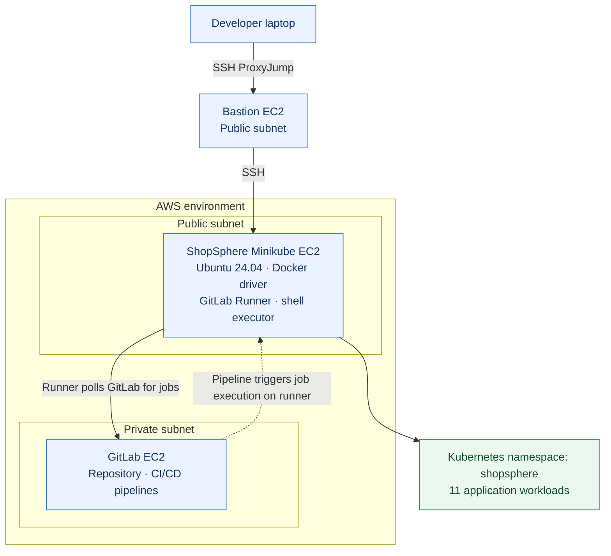

- The Minikube host has its own security group. Inbound is **SSH only**: from the bastion's security group, and from the Jenkins server's single address (`/32`) for deploys. Nothing else is exposed.
- The frontend Service is `ClusterIP`. I reach it with `kubectl port-forward` through an SSH tunnel, so there is no public load balancer.
- The Minikube host sits in a public subnet so it can pull images without a NAT gateway (a NAT gateway is the most expensive idle resource in this setup).
- Host: Ubuntu 24.04 on `m7i-flex.large` (2 vCPU, 8 GiB), 40 GB gp3, 4 GB swap. Minikube runs with `--driver=docker --cpus=2 --memory=6144`.

### Service call graph


### Ports

| Service | Container port | Service port |
|---|---|---|
| frontend | 8080 | 80 |
| productcatalogservice | 3550 | 3550 |
| currencyservice | 7000 | 7000 |
| cartservice | 7070 | 7070 |
| shippingservice | 50051 | 50051 |
| paymentservice | 50051 | 50051 |
| emailservice | **8080** | **5000** |
| recommendationservice | 8080 | 8080 |
| checkoutservice | 5050 | 5050 |
| adservice | 9555 | 9555 |
| redis-cart | 6379 | 6379 |

The load generator from the upstream demo is intentionally not deployed (the node only has 2 vCPUs).

---

## Repository layout

```
.
├── upstream/                 # original Online Boutique release manifest (unchanged)
├── k8s/                      # my manifests, applied by CI
│   ├── 00-namespace.yaml
│   ├── 01-rbac.yaml          # ServiceAccounts, read-only Role
│   ├── 02-networkpolicies.yaml
│   ├── 03-egress-policies.yaml # per-service egress allow-lists, DNS, default-deny-egress
│   └── <service>.yaml        # one Deployment + Service per service (11 files)
├── bootstrap/
│   ├── ci-deployer.yaml      # least-privilege identity for GitLab CI (applied by hand, NOT by CI)
│   └── jenkins-deployer.yaml # least-privilege identity for Jenkins (applied by hand)
├── infra/
│   ├── terraform/            # Minikube EC2 instance and its security group (state is local and not committed)
│   └── ansible/              # host setup playbook, run on the host itself
├── monitoring/               # Helm values and alert rules (applied by hand, NOT by CI)
│   ├── monitoring-values.yaml
│   ├── blackbox-values.yaml
│   ├── shopsphere-probe.yaml
│   ├── alert-sink.yaml
│   └── shopsphere-alerts.yaml
├── docs/                     # screenshots and notes
├── .gitlab-ci.yml
└── Jenkinsfile               # Jenkins deploy pipeline (manual, with auto-rollback)
```

---

## What is implemented

### 1. Manifests (`k8s/`)

- One namespace, `shopsphere`. Every object carries `app` and `app.kubernetes.io/part-of` labels.
- **Probes** on every workload: gRPC probes for the gRPC services, an HTTP probe on `/_healthz` for the frontend, and a TCP readiness plus `redis-cli ping` liveness probe for Redis.
- **Readiness gate for `cartservice`.** The `cartservice` image has no shell, so its own gRPC probe cannot check Redis. A small `redis-check` sidecar (`busybox:1.36`, 5m CPU / 4Mi memory requested) runs `nc -z` against the same `REDIS_ADDR` as the app, every 5 seconds. A pod is Ready only when both containers are Ready, so a pod that cannot reach Redis never receives traffic and never replaces a working pod during a rollout.
- **Requests and limits** chosen from real usage (`kubectl top`), not copied blindly:

| Workload | CPU request / limit | Memory request / limit |
|---|---|---|
| most gRPC services (currency, productcatalog, shipping, payment, email, checkout) | 20m / 200m | 32Mi / 128Mi |
| cartservice | 30m / 200m | 48Mi / 128Mi |
| frontend | 20m / 200m | 64Mi / 128Mi |
| recommendationservice | 30m / 200m | 128Mi / 450Mi |
| adservice (JVM, slower start) | 20m / 300m | 128Mi / 300Mi |
| redis-cart | 20m / 100m | 32Mi / 128Mi |

### 2. RBAC

- Every service has its **own ServiceAccount** with `automountServiceAccountToken: false`. None of these services talks to the Kubernetes API, so no token is mounted into the pods.
- `ops-viewer`: a namespaced, read-only Role (get/list/watch on pods, pod logs, services, deployments) with a RoleBinding. It cannot delete anything or read secrets.

### 3. NetworkPolicies

- default-deny-ingress applies to pods across the namespace. The file defines 11 destination-specific allow policies: 10 service-to-service rules and one frontend ingress rule. The frontend rule allows traffic to pod port 8080 without a source-selector restriction.
- Rules use container ports, not Service ports (this matters for emailservice).
- Ingress is restricted by policy rules.
- **Egress** (`k8s/03-egress-policies.yaml`, 6 policies): `allow-egress-dns` lets every pod reach CoreDNS on port 53. Four policies allow only the calls in the service call graph, on container ports: `frontend` (7 services), `checkoutservice` (6), `recommendationservice` (1) and `cartservice` (Redis only). `default-deny-egress` is last in the file. All other pods can only resolve DNS. The file name sorts after `02-` so CI applies it before the Deployments.
- Egress was tested on the `kindnet` CNI: in a throwaway namespace, a deny-all egress policy turned a working request into `bad address` (DNS is blocked too). In `shopsphere`, an unlabelled test pod could not connect to `frontend:80` or `1.1.1.1:443`, and a complete order (add to cart, checkout, payment, confirmation email) still succeeded through the allowed paths. Details under Verification.
- Enforcement was verified on the original Minikube profile (default `kindnet` CNI, image `kindest/kindnetd:v20260820-69b56db7`). In a throwaway namespace, a deny-all policy turned a working request into a timeout. In `shopsphere`, a test pod without a permitted label could not reach `paymentservice`, while a pod labelled `app=checkoutservice` could. This covers the tested paths only, not every rule or egress behaviour.
- Additional test: on a separate `netpol-test` Minikube profile using Calico, three permitted connections succeeded and three denied connections timed out (details under Verification). This is independent of the `kindnet` result above.

### 4. CI/CD (GitLab CI)

A shell runner on the Minikube host runs two stages:

| Stage | What it does | When |
|---|---|---|
| `validate` | `kubectl apply --dry-run=server` on all manifests | every push |
| `deploy` | `kubectl apply`, then `kubectl rollout status` for every deployment | `main` branch only |

The pipeline does **not** use an admin kubeconfig. It uses a dedicated `ci-deployer` ServiceAccount whose Role can create/update/patch deployments, services and network policies in `shopsphere`, and nothing else. It cannot delete, cannot read secrets, cannot touch RBAC objects and cannot reach other namespaces. For that reason the pipeline skips `00-namespace.yaml` and `01-rbac.yaml`; those are applied by an admin.

**Demo:** changing `replicas: 1` to `replicas: 2` in `k8s/frontend.yaml` and pushing created a second frontend pod with no manual `kubectl apply`. Pushing `replicas: 1` scaled it back. Rollback is a git commit.

### CI/CD evidence

The screenshots below are historical examples from pipeline #12, showing the validation and frontend scale-up demonstration. They are not screenshots of the latest pipeline.

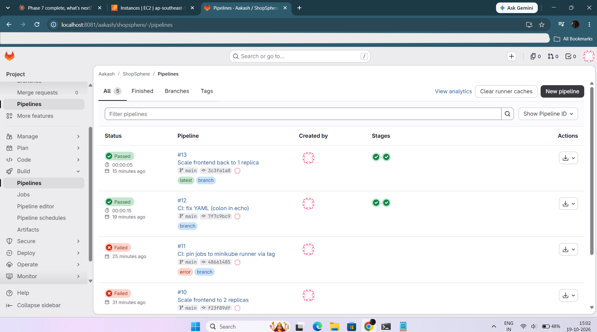
*Historical pipeline list: pipelines #9–#11 failed due to the YAML parsing issue documented below; #12 and #13 passed at the time of capture.*

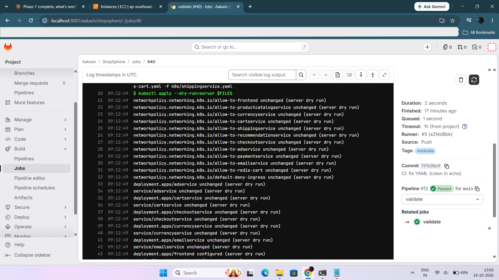
*Historical validation job: server-side dry run reports the planned frontend change.*

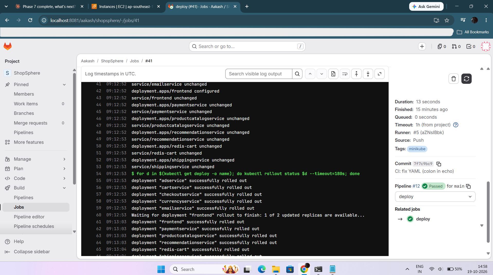
*Historical deploy job: the frontend rollout waits for the second replica and succeeds.*

**Latest recorded verification:** the commit `docs: improve NetworkPolicy verification and setup guide` passed the GitLab validation and deployment stages. The deploy job applied the manifests and all 11 application deployments rolled out successfully.

### 4b. CI/CD (Jenkins)

A second pipeline deploys the same `k8s/` manifests from Jenkins. GitLab CI keeps deploying on every push to `main`. The Jenkins job `shopsphere-deploy` is started by hand (`Build with Parameters`), so the two pipelines never fight over the same push. Jenkins runs in the private subnet and checks the repository out from the lab's GitLab over its private address.

| Stage | What it does |
|---|---|
| `Validate` | Sends the manifests over SSH and runs `kubectl apply --dry-run=server` |
| `Deploy` (only if the `DEPLOY` parameter is ticked) | Records each Deployment's `generation`, applies the manifests, waits for `rollout status` (180 s per Deployment), and rolls back what failed |
| `Verify` | Lists the pods |

**Least privilege.** Jenkins does not use an admin kubeconfig. The job logs in over SSH as a dedicated `jenkins-deploy` user on the Minikube host. That user's kubeconfig only holds the `jenkins-deployer` ServiceAccount (`bootstrap/jenkins-deployer.yaml`). Its Role can create, update and patch deployments, services and network policies, read ReplicaSets (needed for `rollout undo`) and read pods and logs in `shopsphere`. It cannot read secrets, delete deployments or touch RBAC objects.

| Check | Result |
|---|---|
| `kubectl auth can-i patch deployments`, `get replicasets`, `get pods` as `jenkins-deployer` | `yes` |
| `kubectl auth can-i get secrets`, `delete deployments`, `create roles` | `no` |
| `kubectl get secrets` through the Jenkins SSH path | `Forbidden` |

**SSH hardening.** The Jenkins server has its own SSH key. On the Minikube host the public key is restricted with `from="<jenkins private IP>"`, `no-port-forwarding`, `no-agent-forwarding` and `no-X11-forwarding`. The Minikube security group allows SSH from the Jenkins server's single address (`/32`) and not from the whole private security group, which also contains the Git server and the app server.

**Scoped auto-rollback.** After applying, the pipeline compares each Deployment's `generation` with the value from before. Only Deployments changed by this run are rolled back with `kubectl rollout undo`. A Deployment that was already unhealthy but not touched by this run fails the build without being rolled back. This avoids the mistake from the lessons below, where `rollout undo` was run when nothing had changed and moved a Deployment to an older revision.

**Rollback demo.** I committed a deliberately bad `adservice` image to a `rollback-demo` branch (commit message `test: deliberately bad image to demo auto-rollback`) and ran the Jenkins job on it. GitLab CI deploys only from `main`, so it did not touch the cluster. The console of build #4 shows the sequence:

| Time | Console line | Meaning |
|---|---|---|
| 16:24:56 | `deployment.apps/adservice configured (server dry run)` | `Validate` passes. A server-side dry run does not check that an image can be pulled |
| 16:25:00 | `Changed by this deploy: adservice` | Only `adservice` had a new `generation` |
| 16:25:01 | `Waiting for deployment "adservice" rollout to finish: 1 old replicas are pending termination...` | The new pod never became ready |
| 16:28:07 | `error: timed out waiting for the condition` | The 180 s timeout ran out; the other ten Deployments reported `successfully rolled out` |
| 16:28:07 | `Rolling back adservice` then `deployment.apps/adservice rolled back` | `rollout undo` for `adservice` only |
| 16:28:07 | `Deploy failed for: adservice`, `Stage "Verify" skipped`, `Finished: FAILURE` | The build is marked failed even though the rollback worked |

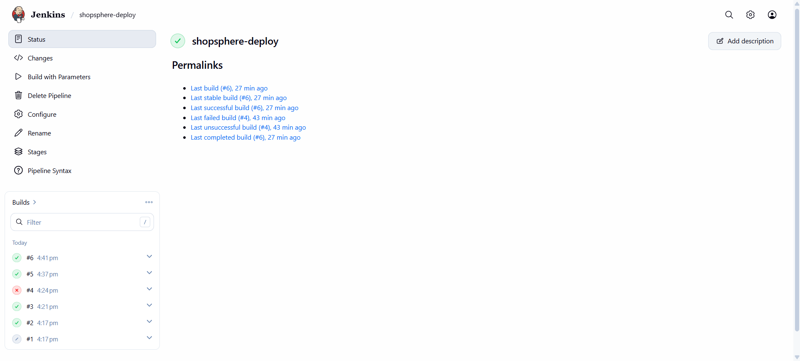
*Build history of `shopsphere-deploy`. #4 is the rollback demo; #5 and #6 are green runs on `main`.*

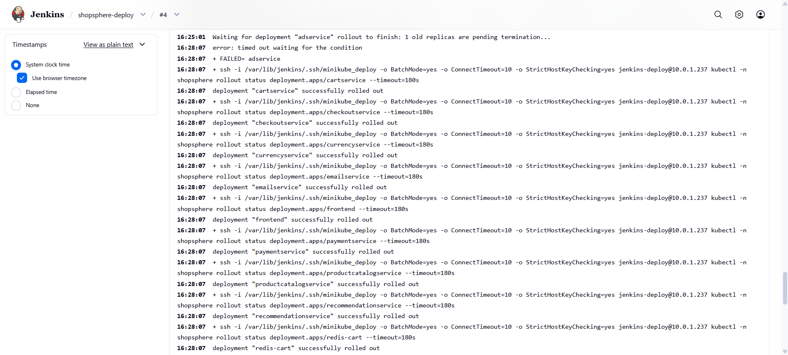
*Build #4: the `adservice` rollout never finishes and times out. The other Deployments report `successfully rolled out`.*

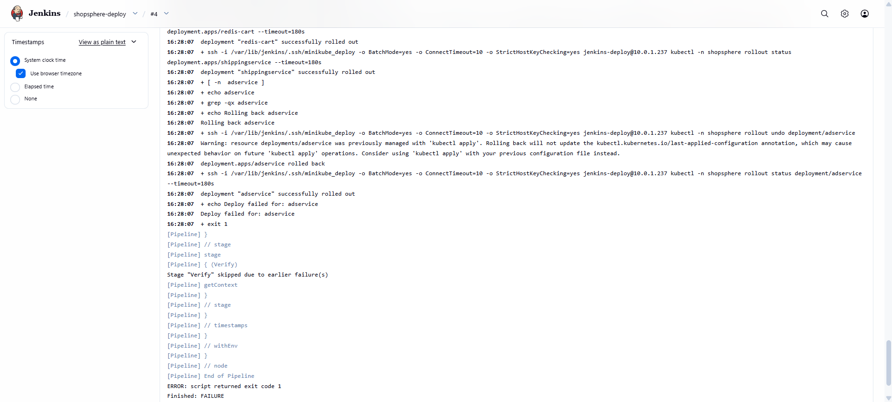
*Build #4: `Rolling back adservice`, `deployment.apps/adservice rolled back`, `Deploy failed for: adservice`. `Verify` is skipped and the build ends as FAILURE.*

Then I ran the job on `main` (build #6). It printed `Changed by this deploy: none`, every Deployment reported `successfully rolled out`, `Verify` listed all 11 pods as `1/1 Running`, and the build ended with `Finished: SUCCESS`. `adservice` was on `v0.10.7`, `kubectl diff` was empty and the rollout history for `adservice` was revisions 1, 3 and 4.

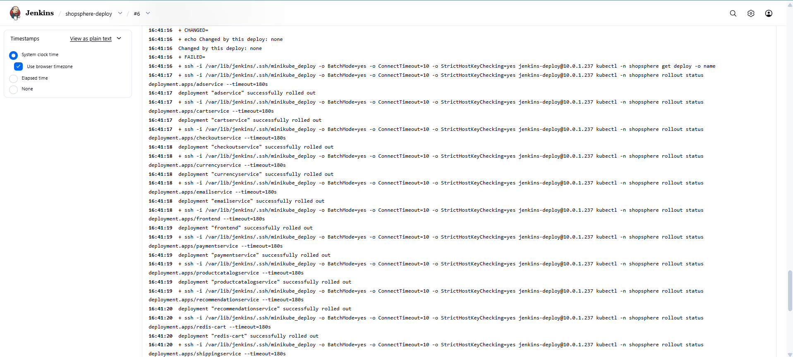
*Build #6: `Changed by this deploy: none`, so no rollback was needed.*

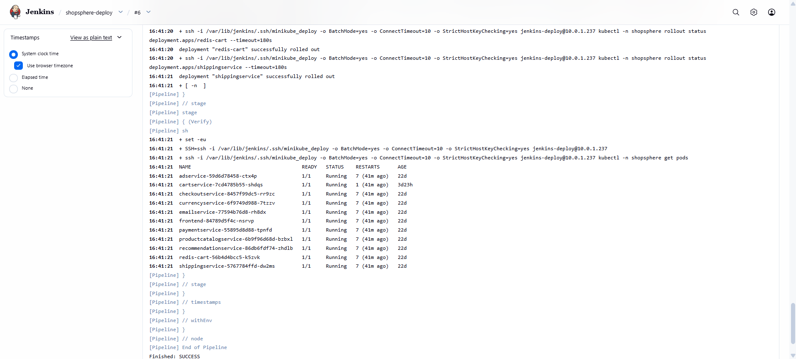
*Build #6: `Verify` lists all 11 pods as `1/1 Running` and the build ends with `Finished: SUCCESS`.*

### 5. Monitoring (Prometheus and Grafana)

Prometheus and Grafana run in a separate `monitoring` namespace, installed from the `kube-prometheus-stack` Helm chart (version `92.17.0`). The Helm values are in `monitoring/monitoring-values.yaml` and the alert rules in `monitoring/shopsphere-alerts.yaml`. Both are applied by hand, not by CI.

- **Installed:** Prometheus, Grafana, the Prometheus Operator and kube-state-metrics, plus the Prometheus blackbox exporter (chart `prometheus-blackbox-exporter` `11.20.2`, 64Mi memory limit) that was added later for the synthetic check described below. Alertmanager and a small webhook receiver were added last (see Notifications).
- **Left out to save memory on the 8 GiB node:** node-exporter and the scrape targets for etcd, scheduler, controller-manager and kube-proxy.
- **Limits:** Prometheus keeps 2 days of data, and Prometheus and Grafana both have resource requests and limits.
- **Metrics used:** the dashboards use cluster metrics (cAdvisor and kube-state-metrics), and the `/cart` probe adds `probe_success`. No application-level metrics are collected.
- **Access:** Grafana is reached the same way as the shop: `kubectl port-forward` plus an SSH tunnel, at `http://localhost:3000`. There is no public endpoint.

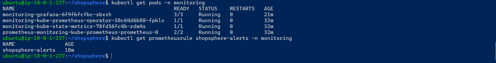
*The monitoring stack is running in the `monitoring` namespace, and the `shopsphere-alerts` rule object is loaded.*

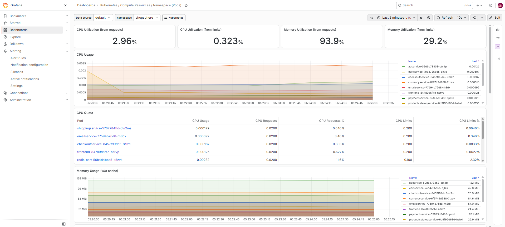
*Baseline: the built-in `Kubernetes / Compute Resources / Namespace (Pods)` dashboard for `shopsphere`. Memory is about 94% of requests but 29% of limits, because requests were set close to measured usage.*

**Alert rules**

| Alert | Fires when | For | Severity |
|---|---|---|---|
| `ShopSpherePodCrashLooping` | a `shopsphere` container was in `CrashLoopBackOff` at any point in the last 2 minutes | 1 min | critical |
| `ShopSpherePodNotReady` | a `shopsphere` pod's Ready condition is false | 2 min | warning |
| `ShopSphereCartEndpointDown` | the synthetic probe of `/cart` fails (added after test 2 below) | 1 min | critical |

Alertmanager was still disabled during the three failure tests below, so the rule states were only visible in Grafana's alert list. Notifications are covered under Notifications.

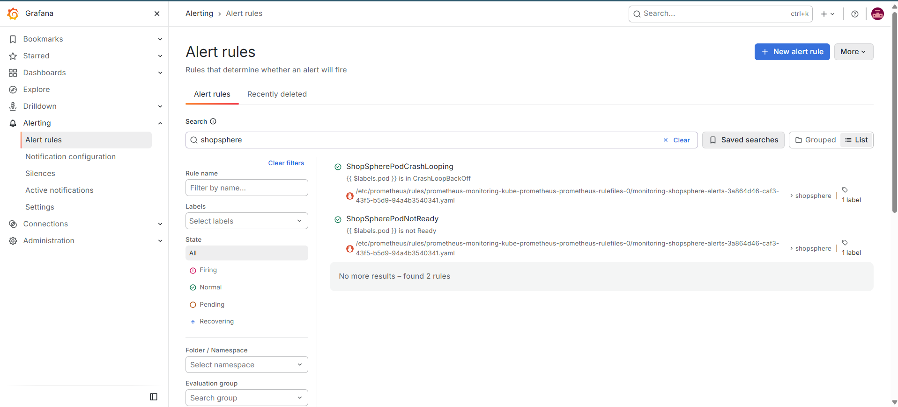
*Both rules in the Normal state before the tests.*

**Failure tests**

I broke `cartservice` on purpose twice and checked what the monitoring showed. After each test I restored the Deployment with `kubectl apply -f k8s/cartservice.yaml` and confirmed that `kubectl diff` was empty.

*Test 1: memory limit too low.* I set a memory request of 8Mi and a limit of 10Mi on `cartservice`. The new pod was `OOMKilled` (exit code 137) and went into `CrashLoopBackOff`. The old pod stayed `1/1 Running`, because the new one never became Ready, so the shop kept working. Both alerts fired and the restart counter kept climbing.

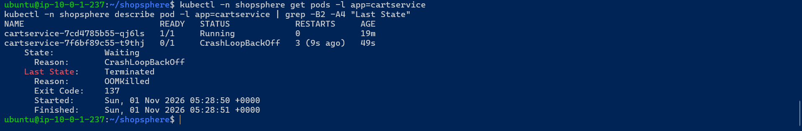
*The new pod is in `CrashLoopBackOff` with `OOMKilled` and exit code 137, while the old pod keeps running.*

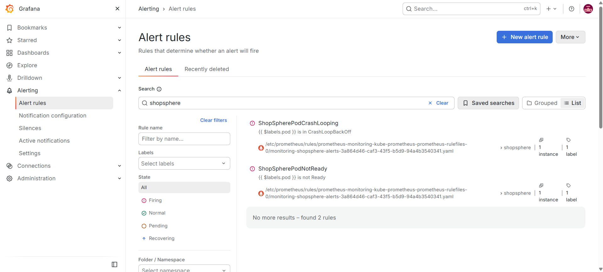
*Both alert rules firing.*

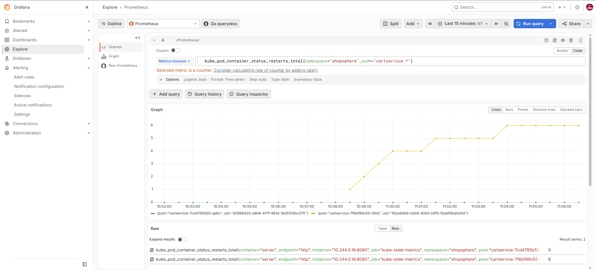
*The restart counter of the new pod climbing (`kube_pod_container_status_restarts_total` in Grafana Explore); the old pod stays at 0.*

*Test 2: wrong Redis address.* I set `REDIS_ADDR=wrong-redis:6379` on `cartservice`. The rollout completed and the pod was `1/1 Running` with 0 restarts. A request to `/cart` returned HTTP 500, and the frontend log showed `UnableToConnect on wrong-redis:6379` after the Redis client timed out (5000 ms). Neither alert fired.

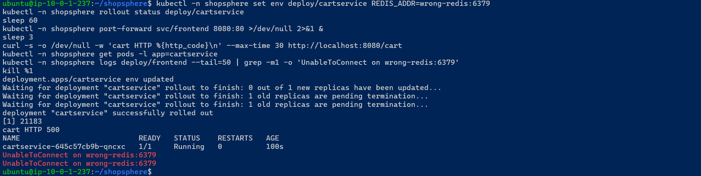
*`cartservice` is `1/1 Running`, yet `/cart` returns HTTP 500 and the log shows `UnableToConnect`.*

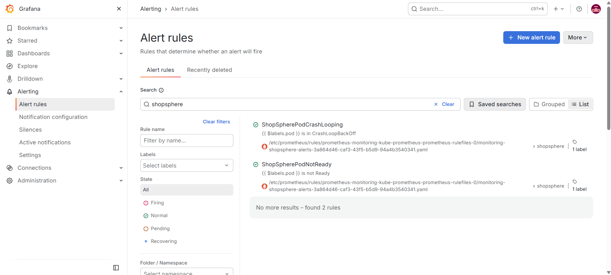
*Taken while the wrong address was live: both rules are still Normal.*

*Test 3: wrong Redis address again, with a synthetic check.* The pod-level alerts cannot see test 2, so I added a check on what users see. A blackbox exporter probes `http://frontend.shopsphere.svc.cluster.local/cart` every 30 seconds (`probe_success`), and `ShopSphereCartEndpointDown` fires after one minute of failures. The probe runs from the `monitoring` namespace and reaches the frontend through the existing `allow-to-frontend` NetworkPolicy, so no extra policy was needed. I then repeated test 2: the pod was `1/1 Running` again, `ShopSphereCartEndpointDown` fired and the two pod-level alerts stayed Normal. After the restore, `probe_success` went back to 1.

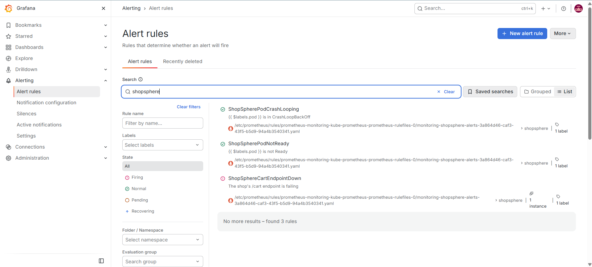
*Wrong `REDIS_ADDR` live: `ShopSphereCartEndpointDown` is firing while `ShopSpherePodCrashLooping` and `ShopSpherePodNotReady` stay Normal.*

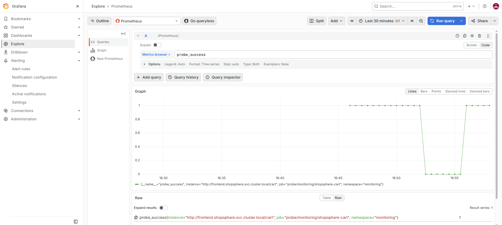
*`probe_success` for the `/cart` probe: 1, then 0 while the wrong address was live, then 1 again after the restore.*

| Failure | Pod status | Alerts | Caught? |
|---|---|---|---|
| Memory limit too low (10Mi) | `OOMKilled`, then `CrashLoopBackOff` | both pod-level alerts fired | Yes |
| Wrong Redis address, pod-level alerts only | `1/1 Running`, 0 restarts | none | No |
| Wrong Redis address, with the `/cart` probe | `1/1 Running`, 0 restarts | `ShopSphereCartEndpointDown` fired | Yes |

The pod-level alerts catch crashes and pods that are not Ready, but not a broken dependency behind a pod that looks healthy. The `/cart` probe closes that gap by checking what users see. That test was run before the readiness gate existed, when the bad pod still became Ready. With the gate in place (section 1) the same mistake no longer reaches users, and the `/cart` probe remains as the check on what users actually see.

**Notifications**

Alertmanager is enabled in the same Helm release (32Mi memory request, 128Mi limit) and routes by severity:

| Severity | Receiver | Webhook path |
|---|---|---|
| `critical` | `webhook-critical` | `/critical` |
| `warning` | `webhook-warning` | `/warning` |
| anything else (for example the built-in Watchdog) | `null` | none |

Both webhooks post to `alert-sink` (`monitoring/alert-sink.yaml`), a small Python HTTP server in the `monitoring` namespace that prints one log line per alert: status, alert name, severity and summary. I used it first so the routing could be shown without any token or webhook URL in the repo. Slack was added afterwards (below), and the sink stays as a second receiver on the same routes.

To check both routes at once I repeated the 10Mi memory-limit test (test 1). The sink log shows each alert on its own path, and the matching `resolved` messages after I restored the Deployment:

```
/critical firing ShopSpherePodCrashLooping critical cartservice-7f6bf89c55-whtgx is in CrashLoopBackOff
/warning firing ShopSpherePodNotReady warning cartservice-7f6bf89c55-whtgx is not Ready
/warning resolved ShopSpherePodNotReady warning cartservice-7f6bf89c55-whtgx is not Ready
/critical resolved ShopSpherePodCrashLooping critical cartservice-7f6bf89c55-whtgx is in CrashLoopBackOff
```

**Slack.** Both receivers also have a `slack_configs` entry that posts to a Slack Incoming Webhook. The webhook URL is a secret, so it is not in the values file or the repo:

- The URL lives in a Kubernetes Secret, `slack-webhook` (key `url`), created by hand from a hidden prompt (`read -s`), so it never appears on screen, in shell history or in a file.
- `alertmanagerSpec.secrets: [slack-webhook]` makes the Prometheus Operator mount the Secret into the Alertmanager pod at `/etc/alertmanager/secrets/slack-webhook/url`.
- The Slack config reads it with `api_url_file`, so the config only contains the file path.

I tested it two ways. A direct `curl` POST to the webhook returned HTTP 200 and the message appeared in Slack. Then I sent a test alert straight to Alertmanager with `amtool alert add SlackTest severity=warning namespace=shopsphere`. The alert-sink log showed `/warning firing SlackTest warning Test alert: Slack channel works`, and Slack showed `[FIRING] SlackTest (warning)`.

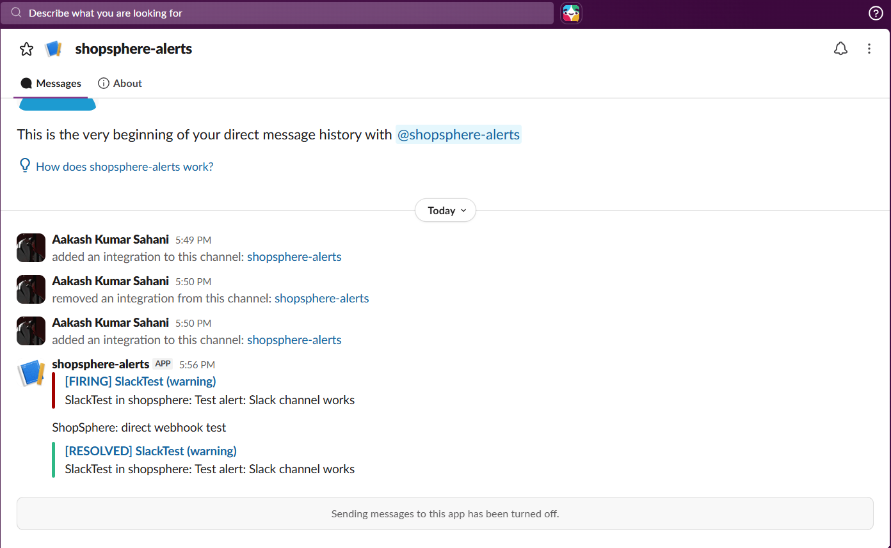
*The test alert in Slack: `[FIRING] SlackTest (warning)`, the direct webhook test message, and `[RESOLVED] SlackTest (warning)` about five minutes later.*

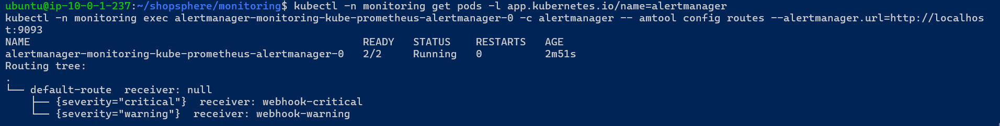
*Alertmanager routing tree (`amtool config routes`): default receiver `null`, critical to `webhook-critical`, warning to `webhook-warning`.*

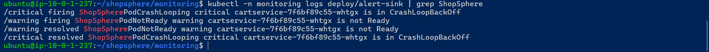
*The `alert-sink` log after the memory-limit test: `firing` and `resolved` messages, each on the path for its severity.*

### 6. Infrastructure as code (`infra/`)

**Terraform** (`infra/terraform/`) describes the Minikube EC2 instance (`m7i-flex.large`, 40 GB gp3 root volume, IMDSv2 required, `prevent_destroy`) and its security group `shopsphere-sg`. Inbound is SSH from the bastion's security group and SSH from the Jenkins server's `/32`; nothing else. The instance and the group already existed, so I imported them instead of recreating them. State is local and gitignored. The VPC, subnets, bastion, GitLab, Jenkins and the Git server are not managed by it.

**Ansible** (`infra/ansible/site.yml`) sets up the host itself: swap, Docker, pinned `minikube`, `kubectl` and `helm` (downloads checked against sha256), the GitLab Runner package, and the restricted `jenkins-deploy` user. Starting the cluster and building the deploy user's kubeconfig are opt-in. Registering the runner stays manual because it needs a token, and no secrets are stored in the repository. See `infra/ansible/README.md`.

---

## Verification

| Check | Evidence / command | Result |
|---|---|---|
| Application health | `kubectl get pods -n shopsphere` on the original `minikube` profile | All 11 application pods were `1/1 Running` in the latest health check; historical synchronized restarts were observed and the exact root cause was not confirmed |
| Deployment rollout | `kubectl rollout status` for each deployment | All 11 deployments successfully rolled out |
| Frontend HTTP response | `curl -I http://127.0.0.1:8080` while forwarding `svc/frontend` port 80 to local port 8080 | `HTTP/1.1 200 OK` |
| End to end | Add an item to the cart and place a test order through the browser | Successfully completed in the latest smoke test; order flow reached completion |
| `ops-viewer` rights | `kubectl auth can-i list pods -n shopsphere --as=system:serviceaccount:shopsphere:ops-viewer` | `yes` (previously tested) |
| `ops-viewer` limits | Same check with `delete pods`, `get secrets`, or namespace `default` | `no` (previously tested) |
| `ci-deployer` rights and limits | `kubectl auth can-i` checks using its kubeconfig | Previously tested; the pipeline also successfully completed validate and deploy stages |
| NetworkPolicy enforcement | Deny-all test in a throwaway namespace, then `nc -w 3 paymentservice 50051` from an unlabelled pod and from a pod labelled `app=checkoutservice` in `shopsphere` (original profile, `kindnet` CNI) | Deny-all caused a timeout; the unlabelled pod failed (`exit=1`), the labelled pod succeeded (`exit=0`) |
| Egress enforcement (canary) | Throwaway namespace, `wget` to `frontend.shopsphere`, then a deny-all egress policy | Before: exit 0. After: `bad address` (exit 1) |
| Egress, unlabelled pod | `nc -z -w 3 frontend 80` and `nc -z -w 3 1.1.1.1 443` from a pod without allow rules, with the 6 egress policies applied | Both exit 1, on a pre-existing pod and on a new pod, immediately and 20 s later |
| Egress, new-pod start | New pod running 8 attempts, 1 s apart, to `1.1.1.1:443` | Attempt 1 open, attempts 2 to 8 blocked: about 1 s before the policy applies |
| Egress, allowed paths | Order through the frontend (`/`, add to cart, `/cart`, checkout) with all 6 policies applied | 200, 302, 200, 200; page shows `order is complete`; `checkoutservice` logs show payment and confirmation email |
| Egress and monitoring | `probe_success` for the `/cart` probe after re-applying the policies | `1` |
| Egress, DNS removed | Deleted `allow-egress-dns` and `default-deny-egress` while the four service policies remained | `cartservice` went `1/2` (readiness gate) and returned to `2/2` about 15 s after the DNS policy was re-created |
| `jenkins-deployer` rights and limits | `kubectl auth can-i` as the ServiceAccount, and `get pods` / `get secrets` over the Jenkins SSH path | `yes` for patch deployments, get replicasets and pods; `no` for secrets, delete deployments, create roles (section 4b) |
| Jenkins rollback | Branch `rollback-demo` with a bad `adservice` image, job `shopsphere-deploy` | Build #4: dry run passed, rollout timed out after 180 s, `Rolling back adservice`, `Finished: FAILURE` |
| Jenkins deploy on `main` | Same job after the demo | Build #6: `Changed by this deploy: none`, 11 pods `1/1 Running`, `Finished: SUCCESS`; `kubectl diff` empty |
| Monitoring stack | `kubectl get pods -n monitoring`, Grafana dashboards and alert rules | Prometheus, Grafana, the operator and kube-state-metrics `Running`; both alert rules loaded (section 5) |
| Alert test: OOM / CrashLoop | `cartservice` with a 10Mi memory limit | `OOMKilled`, `CrashLoopBackOff`; both alerts fired |
| Alert test: wrong Redis address | `REDIS_ADDR=wrong-redis:6379` on `cartservice` | Pod stayed `1/1 Running`, `/cart` returned HTTP 500, no pod-level alert fired |
| Slack notification | Direct `curl` to the webhook, then `amtool alert add SlackTest severity=warning` | HTTP 200; `/warning firing SlackTest` in the sink log; `[FIRING]` and, five minutes later, `[RESOLVED] SlackTest (warning)` in Slack |
| Notification routing | `amtool config routes`, then the 10Mi memory-limit test | Critical alert on `/critical`, warning alert on `/warning`, and both `resolved` after the restore (section 5) |
| Readiness gate, wrong Redis address | `kubectl set env deploy/cartservice REDIS_ADDR=redis-cart-wrong:6379` (applied to both containers) | New pod stayed `1/2`, event `Readiness probe failed: nc: bad address 'redis-cart-wrong'`, the old `2/2` pod kept serving, `rollout status` timed out |
| Readiness gate, restore | `kubectl apply -f k8s/cartservice.yaml`, then `kubectl diff -f k8s/` | `successfully rolled out`, one pod `2/2 Running`, diff empty |
| Terraform import and drift | `terraform import` for the security group and the instance, then `terraform plan` | The instance matched. The security group did not: the live group also allowed SSH from the whole private security group, which this README said was not the case |
| Terraform apply | `terraform apply`, then `terraform plan` and `aws ec2 describe-security-groups` | `1 changed`, then `No changes`; the group lists only the bastion security group and `10.0.2.160/32` for SSH |
| Ansible on the existing host | `ansible-playbook --check --diff`, then the real run, then a second run (ansible-core 2.16.3) | Dry run `changed=1` (`.kube` directory owned by root, mode 755); real run `changed=1`; second run `changed=0`, `failed=0` |
| Synthetic check | same wrong `REDIS_ADDR`, with the `/cart` probe | `ShopSphereCartEndpointDown` fired while the pod stayed `1/1 Running`; `probe_success` went 1, 0, 1 after the restore |

### Additional NetworkPolicy test (separate Calico profile)

A second Minikube profile, `netpol-test`, was created with the Calico CNI for an additional check. It is separate from the main `kindnet` cluster. The Calico version was not recorded. The temporary test pods were deleted afterwards and the profile was stopped.

| Destination | Permitted test pod | Denied test pod | Result |
|---|---|---|---|
| `paymentservice:50051` | `netpol-allow-checkout` (`app=checkoutservice`): connection open | `netpol-deny` (`app=netpol-test`): connection timed out | Pass |
| `emailservice:5000` | `netpol-allow-checkout` (`app=checkoutservice`): connection open | `netpol-deny` (`app=netpol-test`): connection timed out | Pass |
| `redis-cart:6379` | `netpol-allow-cart` (`app=cartservice`): connection open | `netpol-deny` (`app=netpol-test`): connection timed out | Pass |

These tests verify the three listed traffic paths only. They do not prove every NetworkPolicy rule or egress behaviour.

---

## Lessons and troubleshooting log

**Pods stuck in `Pending` while the node was almost idle.** The events said `Insufficient cpu`. The scheduler works with CPU *requests*, which were at 97% of the node, while real usage was around 7%. Fix: set requests from `kubectl top` measurements.

**Service port vs container port (emailservice).** `checkoutservice` calls `emailservice:5000`, which is the Kubernetes Service port; the emailservice container listens on port 8080. Keep the distinction clear when debugging connectivity: clients address the Service port, while NetworkPolicy rules are evaluated against traffic to the destination pod port.

**A passing readiness probe does not mean healthy dependencies.** I set `REDIS_ADDR=wrong-host:6379` on `cartservice`. The new pod still became Ready, because its probe only checks that the process is alive, and the rolling update replaced the good pod with the broken one. Mitigations: dependency-aware probes, and monitoring/alerting. I later repeated this test with Prometheus and Grafana in place (section 5): the pod-level alerts did not fire either. A synthetic check on `/cart` (blackbox exporter) does catch it. I closed this gap afterwards with a `redis-check` sidecar on `cartservice` that is part of its readiness (see the next lesson).

**A readiness gate has to live where a shell exists.** The `cartservice` image has no `sh`, so `kubectl exec` and an exec probe both failed with `executable file not found`. The Redis check therefore runs in a `busybox` sidecar in the same pod. It reads the same `REDIS_ADDR` value as the app. The two values are duplicated in the manifest, so they must be changed together.

**Every egress policy needs DNS.** A policy that selects a pod for egress isolates it completely, so a service policy that lists only the target service and port breaks name resolution. `allow-egress-dns` therefore selects all pods. When I deleted it by mistake during testing, `cartservice` went `1/2` because the `redis-check` sidecar most likely could no longer resolve `redis-cart`, and it recovered after the policy was re-created. The readiness gate noticed a DNS problem as well as a Redis one.

**My first egress baseline was invalid.** The "before" test of an egress policy showed the connection already blocked, because the earlier `allow-egress-*` policies were still in the cluster and `allow-egress-dns` (selecting all pods) already isolates every pod. Because of that, `default-deny-egress` is redundant but kept as an explicit statement of the default. A valid baseline needs the policies removed first. The first test pod also reached the internet once, which turned out to be the one-second startup window measured later.

**NetworkPolicy selects pods by labels, not by workload identity.** On the `kindnet` profile, a test pod labelled `app=checkoutservice` was permitted to reach `paymentservice`. A principal allowed to create pods in the namespace may be able to assign a permitted label, so RBAC must restrict pod creation as well as protect privileged resources. The `ops-viewer` role cannot create pods.

**CI kubeconfig and the Minikube CA.** Minikube's kubeconfig points to the CA *file* in the admin user's home directory instead of embedding it. The runner user cannot read it, so kubectl failed with `x509: certificate signed by unknown authority`. Fix: base64-embed the CA into the runner's kubeconfig.

**YAML trap in `.gitlab-ci.yml`.** `- echo "Manifests: $FILES"` is valid YAML, but it parses as a mapping (`{'echo "Manifests': '$FILES"'}`) instead of a string, so GitLab rejected the file and created no jobs (pipelines #9 to #11). Replacing the colon with `=` fixed it. A local `yaml.safe_load` passed the broken file, so it is not a reliable check: use GitLab's Pipeline editor validation instead.

**Configuration drift.** `kubectl set env` changes live state that is not in git. `kubectl rollout undo` plus `kubectl apply -f` brought the cluster back in sync. Git should be the source of truth, and the pipeline enforces that.

**`kubectl rollout undo` when nothing changed.** My first `kubectl set resources` on `cartservice` was rejected by the API server, because the existing 48Mi memory request was above the new 10Mi limit, so nothing changed. I still ran `kubectl rollout undo`, which moved the Deployment back to an older revision that predated the ServiceAccount setting. `kubectl diff -f k8s/cartservice.yaml` showed the difference and `kubectl apply -f` restored the spec from git. Since then I restore with `apply` and check that `kubectl diff` is empty.

**`rollout undo` only for what this run changed.** A rollback that fires for every unhealthy Deployment can move one the run never touched to an older revision (this happened once with a bare `rollout undo`). The pipeline records `generation` before and after the apply and undoes only the changed ones. `rollout undo` also prints a warning that it does not update the `kubectl.kubernetes.io/last-applied-configuration` annotation, so after a rollback I check `kubectl diff -f k8s/` and re-apply the manifest from git if it shows a difference.

**Compare the values file with the live release before `helm upgrade`.** `helm get values monitoring -n monitoring -o yaml` showed that the live release had a Grafana admin password that the values file, correctly, did not contain. The upgrade went through because the chart keeps the existing password Secret, but I had not checked that first and it could have reset the password. The same diff also shows a lot of key re-ordering, so read it for real differences only.

**A mounted Secret must exist before the pod that uses it.** The Alertmanager pod mounts `slack-webhook`, so the Secret has to exist before `helm install` or `helm upgrade`, otherwise the pod stays in `ContainerCreating`. My first attempt to create the Secret also went wrong: a multi-line paste made `read` consume the next pasted line, and the Secret held 41 characters of junk instead of the URL. Checking the length and prefix (not the value) caught it.

**A passing dry run is not a healthy rollout.** In build #4 the server-side dry run succeeded with a bad image. Only the real rollout, with its timeout, caught it.

**Shared security group.** The Jenkins server, the Git server and the app server share one security group. A rule that allowed SSH from that group to the Minikube host would have opened it to all three, so the rule uses the Jenkins server's `/32` address.

**`kubectl port-forward` pins to one pod.** After a rollout replaces the pod, the forward dies. Run it with `nohup` and restart it after deploys.

**Importing existing infrastructure shows the drift.** My README said the Minikube security group did not allow SSH from the whole private group. The first `terraform plan` after the import showed that it did. I had written the claim without checking what AWS reported. Applying the Terraform removed the extra rule, and `describe-security-groups` now confirms it.

**A dry run on the real host finds what a draft misses.** My first Ansible draft put the GitLab Runner key at a different path than the one the GitLab installer had already created, which would likely have left two apt sources for the same repository. `--check --diff` showed it before anything changed.

**Keep Terraform plan files out of git.** I committed `tfplan` because `.gitignore` only listed `*.tfplan`. A plan file can contain account and resource identifiers. I rewrote the branch history the same evening and added the file name to `.gitignore`.

**SSH through a bastion.** The security-group rule "SSH from the bastion's security group" only matches traffic from the bastion's *private* address, so the jump target must be the instance's private IP.

---

## Limitations

- Single node, single replica per service. This is a learning environment, not high availability.
- Redis uses emptyDir, so carts are lost when its pod restarts.
- Egress is restricted per service and tested on `kindnet`, but only with an unlabelled pod (blocked) and one full order (allowed). I did not test every denied edge. A new pod is unrestricted for about one second before the policy applies (one measurement). Rules match pod labels and TCP container ports. Ingress enforcement was tested only on the paths described above, not on every rule.
- Images are pinned by tag (v0.10.7), not by digest.
- No Ingress, TLS or public endpoint by design.
- The ci-deployer token is a long-lived ServiceAccount token stored in the runner user's kubeconfig. Better: short-lived tokens or a hardened runner.
- The GitLab Runner is a shell executor, so jobs run directly on the Minikube host.
- The Jenkins job is manual and its SSH key has no passphrase (it lives on the Jenkins server). The `jenkins-deployer` token is a long-lived ServiceAccount token in the `jenkins-deploy` user's kubeconfig.
- GitLab CI and Jenkins can both deploy to the same namespace. They do not coordinate, so use one at a time.
- Alerts go to Slack and to an in-cluster webhook receiver that only logs them. Only the Slack path was tested with a manual test alert, not with every real alert. The Slack webhook URL is a long-lived secret stored in a Kubernetes Secret, so it must be rotated by hand if it leaks. There is no email channel.
- No persistent volume is configured for Prometheus or Grafana, and Prometheus keeps 2 days of data. Only cluster metrics and the one `/cart` probe are collected, no application metrics.
- Terraform covers only the Minikube instance and its security group, and its state is local (no remote backend, no locking). I have not rebuilt the host from scratch with Terraform and Ansible, so a full destroy and recreate is untested. Ansible was run only against the existing host; the `cluster` and `kubeconfig` tasks have not been run.
- After Terraform removed the broad SSH rule from the security group, I have not yet re-run a Jenkins deploy to confirm the `/32` rule alone is enough.
- The readiness gate covers only the `cartservice` to Redis dependency. Other services do not check their dependencies. Its `REDIS_ADDR` value is duplicated in the sidecar and must be kept in sync. If Redis restarts, `cartservice` goes NotReady until it is back, which is intended.

## Roadmap

- [x] Jenkins deploy pipeline (SSH to the Minikube host) with scoped auto-rollback, alongside GitLab CI
- [x] Monitoring: Prometheus, Grafana and alert rules (`kube-prometheus-stack`)
- [x] Alertmanager with severity-based routing (to an in-cluster webhook receiver)
- [x] A real notification channel (Slack), with the secret in a Kubernetes Secret
- [x] Synthetic check on `/cart` (blackbox exporter) that catches the failure the pod-level alerts missed
- [x] Dependency-aware readiness gate for `cartservice` (Redis), so a bad rollout is stopped instead of only detected
- [ ] Centralised logging
- [x] Egress NetworkPolicies (per-service allow-lists plus default-deny, tested on `kindnet`)
- [ ] Short EKS proof of concept (deferred to a later phase)
- [x] Terraform for the Minikube instance and its security group, and an Ansible playbook for the host (tested on the existing host)
- [ ] Rebuild the host from scratch with Terraform and Ansible on a throwaway instance, then destroy it

---

## Running it

Prerequisites: an Ubuntu host with Docker, `kubectl` and `minikube` installed.

```bash
# The default Minikube CNI (kindnet) enforced the NetworkPolicies used here
minikube start --driver=docker --cpus=2 --memory=6144

# Optional: separate Calico profile, used for the additional NetworkPolicy test
# (--cni only takes effect when the cluster is created)
minikube start -p netpol-test --driver=docker --cni=calico --cpus=2 --memory=6144

# namespace, RBAC, policies and all workloads (files are applied in order)
kubectl apply -f k8s/

# optional: identity used by CI
kubectl apply -f bootstrap/ci-deployer.yaml

kubectl get pods -n shopsphere

# open the shop at http://localhost:8080
kubectl port-forward -n shopsphere --address 127.0.0.1 svc/frontend 8080:80
```

On a remote host, add an SSH tunnel from your laptop: `ssh -N -L 8080:localhost:8080 <host>`.

### Monitoring (optional)

Needs Helm. The chart is installed by hand, not by CI.

```bash
helm repo add prometheus-community https://prometheus-community.github.io/helm-charts
helm repo update
kubectl create namespace monitoring

# Slack webhook URL as a Secret. Create it BEFORE the helm install, because
# the Alertmanager pod mounts it. The prompt hides the input.
read -rsp "Slack webhook URL: " URL; echo
kubectl -n monitoring create secret generic slack-webhook --from-literal=url="$URL"
unset URL

helm install monitoring prometheus-community/kube-prometheus-stack --version 92.17.0 \
  -n monitoring -f monitoring/monitoring-values.yaml \
  --set grafana.adminPassword='<choose-a-password>'

# synthetic check on /cart (blackbox exporter and its Probe)
helm install blackbox prometheus-community/prometheus-blackbox-exporter --version 11.20.2 \
  -n monitoring -f monitoring/blackbox-values.yaml
kubectl apply -f monitoring/shopsphere-probe.yaml

# webhook receiver for Alertmanager (logs every alert it receives)
kubectl apply -f monitoring/alert-sink.yaml

# alert rules for the shopsphere namespace
kubectl apply -f monitoring/shopsphere-alerts.yaml

# Grafana at http://localhost:3000 (user: admin)
kubectl -n monitoring port-forward svc/monitoring-grafana 3000:80
```

On a remote host, add an SSH tunnel: `ssh -N -L 3000:localhost:3000 <host>`.

Later changes to the values file are applied with `helm upgrade monitoring prometheus-community/kube-prometheus-stack --version 92.17.0 -n monitoring --reuse-values -f monitoring/monitoring-values.yaml`. `--reuse-values` keeps the Grafana password that was set with `--set` at install time.

### Jenkins pipeline (optional)

Needs a Jenkins server that can reach the GitLab repository and the Minikube host over SSH.

```bash
# least-privilege identity for Jenkins
kubectl apply -f bootstrap/jenkins-deployer.yaml

# on the Minikube host: a user whose kubeconfig only holds that ServiceAccount
sudo adduser --disabled-password --gecos "" jenkins-deploy
# build a kubeconfig from the jenkins-deployer-token Secret and install it as
# /home/jenkins-deploy/.kube/config (mode 600), without printing the token

# on the Jenkins server: create a key for the jenkins user and add the public key to
# /home/jenkins-deploy/.ssh/authorized_keys with
#   from="<jenkins private IP>",no-port-forwarding,no-agent-forwarding,no-X11-forwarding
```

Then create a Pipeline job from SCM that points at this repository and uses the `Jenkinsfile`. Replace the Minikube host address and key path in the `Jenkinsfile` with your own values.

### Host setup with Terraform and Ansible (optional)

```bash
cd infra/terraform
cp terraform.tfvars.example terraform.tfvars   # set subnet_id, ami_id, key_name
terraform init
# for resources that already exist: terraform import aws_security_group.shopsphere <sg-id>
#                                   terraform import aws_instance.minikube <instance-id>
terraform plan -out=tfplan                      # read it before applying
terraform apply tfplan
```

On the host, from `infra/ansible/`:

```bash
sudo apt-get install -y ansible-core
cp vars.local.yml.example vars.local.yml        # put the Jenkins public key in it
ansible-playbook -i localhost, -c local site.yml -e @vars.local.yml --check --diff
ansible-playbook -i localhost, -c local site.yml -e @vars.local.yml --diff
```

## Cost notes

Instances are stopped between sessions (`minikube stop`, then stop the EC2 instances). No NAT gateway is needed to run this project, because the Minikube host is in a public subnet and GitLab traffic stays on private IPs.

## Credits

Application: [GoogleCloudPlatform/microservices-demo](https://github.com/GoogleCloudPlatform/microservices-demo), licensed under Apache 2.0.
