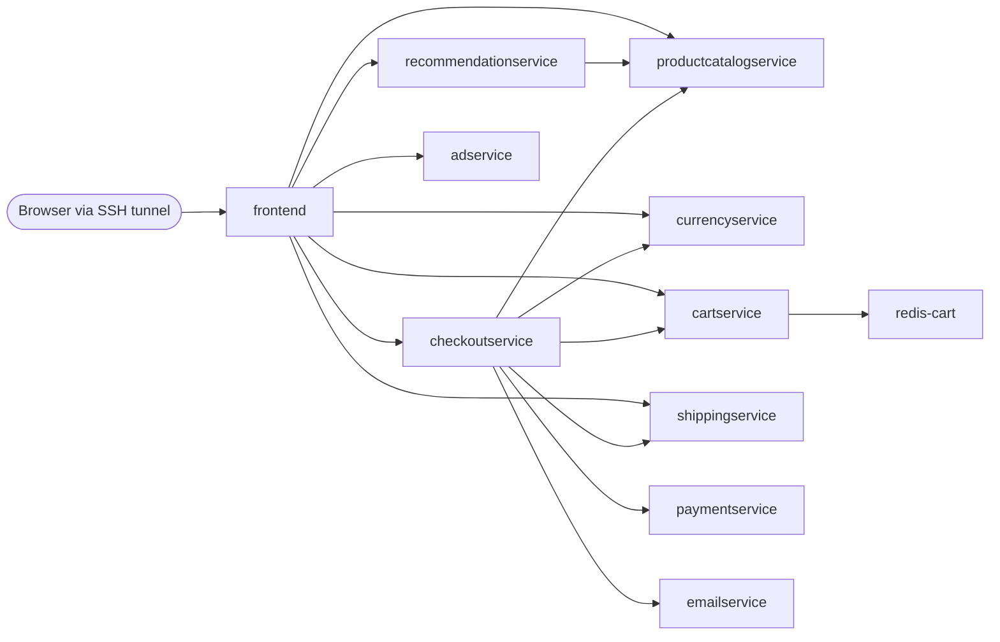
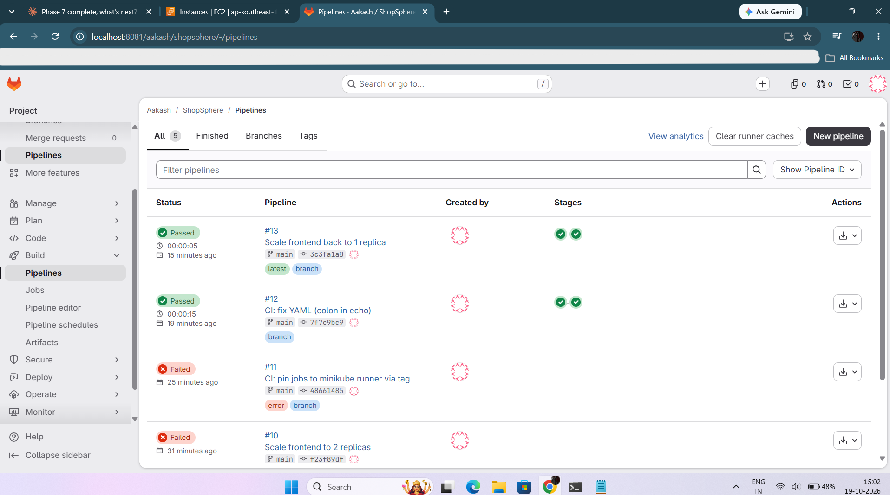
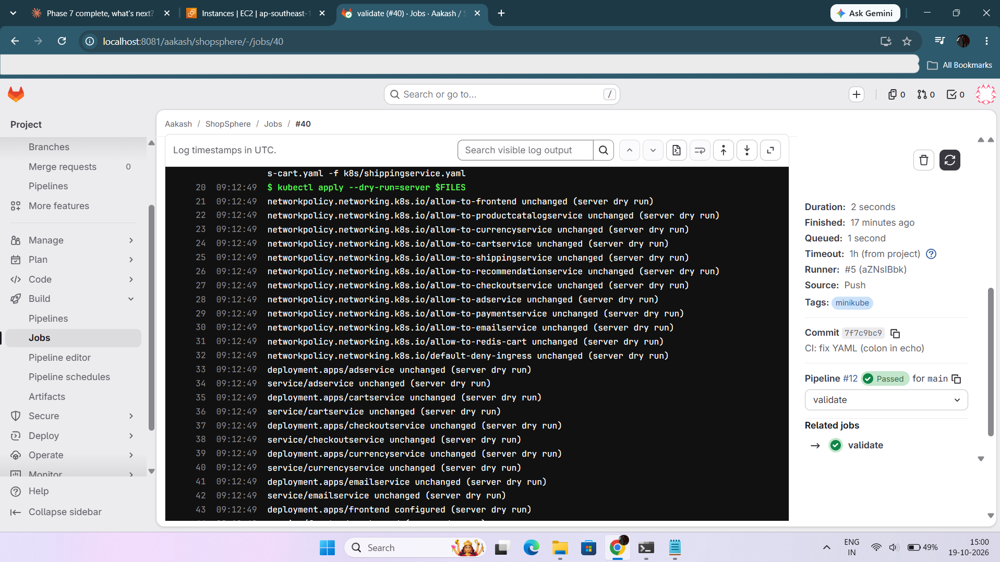
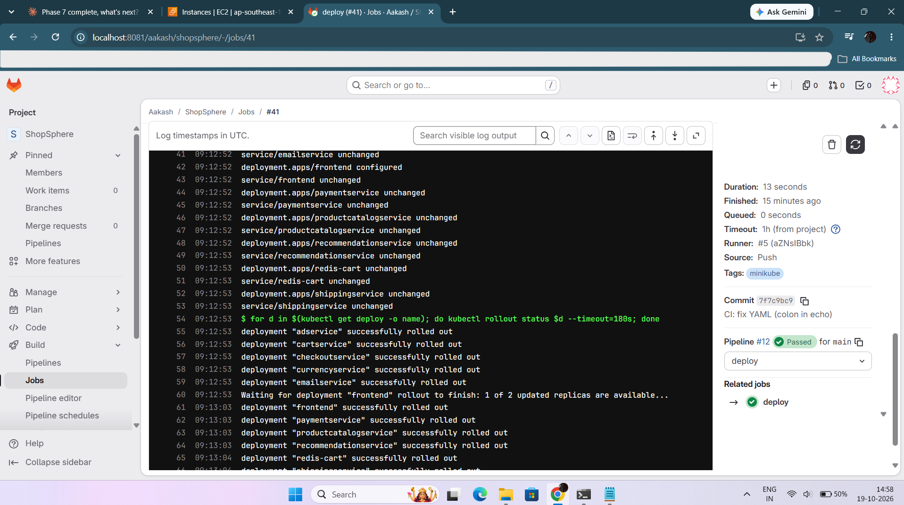

# ShopSphere

A hands-on Kubernetes project: Google's **Online Boutique** (11 microservices) running on **Minikube on an AWS EC2 instance**, with hand-written manifests, per-service RBAC, default-deny NetworkPolicies and a **GitLab CI/CD** pipeline that validates and deploys from git.

The goal was not just to get the demo running, but to write every manifest myself, break things on purpose, and document what I learned.

> The application itself is [GoogleCloudPlatform/microservices-demo](https://github.com/GoogleCloudPlatform/microservices-demo) (Apache 2.0), image version `v0.10.7`. The original release manifest is kept unchanged in `upstream/` for reference. Everything in `k8s/`, `bootstrap/` and `.gitlab-ci.yml` is my own work.

---

## Architecture

```
 Laptop ──SSH (ProxyJump)──▶ Bastion (public subnet)
                                   │
              ┌────────────────────┴─────────────────────┐
              ▼                                          ▼
  shopsphere-minikube (EC2, public subnet)      GitLab (EC2, private subnet)
  - Minikube, Docker driver                     - source repo
  - GitLab Runner (shell executor)  ── polls ─▶ - CI/CD pipelines
  - namespace "shopsphere": 11 workloads
```

- The Minikube host has its own security group. Inbound is **SSH only, from the bastion's security group**. Nothing else is exposed.
- The frontend Service is `ClusterIP`. I reach it with `kubectl port-forward` through an SSH tunnel, so there is no public load balancer.
- The Minikube host sits in a public subnet so it can pull images without a NAT gateway (a NAT gateway is the most expensive idle resource in this setup).
- Host: Ubuntu 24.04 on `m7i-flex.large` (2 vCPU, 8 GiB), 40 GB gp3, 4 GB swap. Minikube runs with `--driver=docker --cpus=2 --memory=6144`.

### Service call graph



### Ports

| Service | Container port | Service port |
|---|---|---|
| frontend | 8080 | 80 |
| productcatalogservice | 3550 | 3550 |
| currencyservice | 7000 | 7000 |
| cartservice | 7070 | 7070 |
| shippingservice | 50051 | 50051 |
| paymentservice | 50051 | 50051 |
| emailservice | **8080** | **5000** |
| recommendationservice | 8080 | 8080 |
| checkoutservice | 5050 | 5050 |
| adservice | 9555 | 9555 |
| redis-cart | 6379 | 6379 |

The load generator from the upstream demo is intentionally not deployed (the node only has 2 vCPUs).

---

## Repository layout

```
.
├── upstream/                 # original Online Boutique release manifest (unchanged)
├── k8s/                      # my manifests, applied by CI
│   ├── 00-namespace.yaml
│   ├── 01-rbac.yaml          # ServiceAccounts, read-only Role
│   ├── 02-networkpolicies.yaml
│   └── <service>.yaml        # one Deployment + Service per service (11 files)
├── bootstrap/
│   └── ci-deployer.yaml      # least-privilege identity for CI (applied by hand, NOT by CI)
├── docs/                     # screenshots and notes
└── .gitlab-ci.yml
```

---

## What is implemented

### 1. Manifests (`k8s/`)

- One namespace, `shopsphere`. Every object carries `app` and `app.kubernetes.io/part-of` labels.
- **Probes** on every workload: gRPC probes for the gRPC services, an HTTP probe on `/_healthz` for the frontend, and a TCP readiness plus `redis-cli ping` liveness probe for Redis.
- **Requests and limits** chosen from real usage (`kubectl top`), not copied blindly:

| Workload | CPU request / limit | Memory request / limit |
|---|---|---|
| most gRPC services (currency, productcatalog, shipping, payment, email, checkout) | 20m / 200m | 32Mi / 128Mi |
| cartservice | 30m / 200m | 48Mi / 128Mi |
| frontend | 20m / 200m | 64Mi / 128Mi |
| recommendationservice | 30m / 200m | 128Mi / 450Mi |
| adservice (JVM, slower start) | 20m / 300m | 128Mi / 300Mi |
| redis-cart | 20m / 100m | 32Mi / 128Mi |

### 2. RBAC

- Every service has its **own ServiceAccount** with `automountServiceAccountToken: false`. None of these services talks to the Kubernetes API, so no token is mounted into the pods.
- `ops-viewer`: a namespaced, read-only Role (get/list/watch on pods, pod logs, services, deployments) with a RoleBinding. It cannot delete anything or read secrets.

### 3. NetworkPolicies

- `default-deny-ingress` for the whole namespace, plus **11 allow rules** that match the call graph above (for example, only `checkoutservice` can reach `paymentservice`, only `cartservice` can reach `redis-cart`).
- Rules are written against **container ports**, not Service ports (this matters for `emailservice`).
- Ingress only for now. Egress is not restricted yet (see Limitations).
- I first verified that Minikube's CNI actually enforces policies, using a throwaway namespace (a deny-all policy made a test request time out) before relying on them.

### 4. CI/CD (GitLab CI)

A shell runner on the Minikube host runs two stages:

| Stage | What it does | When |
|---|---|---|
| `validate` | `kubectl apply --dry-run=server` on all manifests | every push |
| `deploy` | `kubectl apply`, then `kubectl rollout status` for every deployment | `main` branch only |

The pipeline does **not** use an admin kubeconfig. It uses a dedicated `ci-deployer` ServiceAccount whose Role can create/update/patch deployments, services, service accounts and network policies in `shopsphere`, and nothing else. It cannot delete, cannot read secrets, cannot touch RBAC objects and cannot reach other namespaces. For that reason the pipeline skips `00-namespace.yaml` and `01-rbac.yaml`; those are applied by an admin.

**Demo:** changing `replicas: 1` to `replicas: 2` in `k8s/frontend.yaml` and pushing created a second frontend pod with no manual `kubectl apply`. Pushing `replicas: 1` scaled it back. Rollback is a git commit.


*Pipelines #9 to #11 failed, #12 and #13 passed. See "YAML trap" below for why.*


*Server-side dry run correctly reports that only `frontend` would change.*


*The deploy job waits for the frontend rollout ("1 of 2 updated replicas are available") and succeeds.*

---

## Verification

| Check | Command | Expected |
|---|---|---|
| All pods healthy | `kubectl get pods -n shopsphere` | 11 pods `1/1 Running` |
| End to end | place an order in the shop | order confirmation page |
| `ops-viewer` rights | `kubectl auth can-i list pods -n shopsphere --as=system:serviceaccount:shopsphere:ops-viewer` | `yes` |
| `ops-viewer` limits | same with `delete pods`, `get secrets`, or `-n default` | `no` |
| `ci-deployer` rights | `kubectl auth can-i patch deployments` (using its kubeconfig) | `yes` |
| `ci-deployer` limits | `delete deployments`, `create rolebindings`, `get secrets` | `no`; `get pods -n default` is `Forbidden` |
| NetworkPolicy blocks | a random pod runs `nc -w 3 paymentservice 50051` | fails (`exit=1`) |
| NetworkPolicy allows | a pod labelled `app=checkoutservice` runs the same | succeeds (`exit=0`) |

---

## Lessons and troubleshooting log

**Pods stuck in `Pending` while the node was almost idle.** The events said `Insufficient cpu`. The scheduler works with CPU *requests*, which were at 97% of the node, while real usage was around 7%. Fix: set requests from `kubectl top` measurements.

**Service port vs container port (emailservice).** `checkoutservice` calls `emailservice:5000`, but the container listens on 8080. My first generated manifest used 8080 for both. I caught it by reading the real env of `checkoutservice` before the first order. NetworkPolicies must use the container port (8080), not the Service port.

**A passing readiness probe does not mean healthy dependencies.** I set `REDIS_ADDR=wrong-host:6379` on `cartservice`. The new pod still became Ready, because its probe only checks that the process is alive, and the rolling update replaced the good pod with the broken one. Mitigations: dependency-aware probes, and monitoring/alerting (planned).

**NetworkPolicy is label-based.** A pod created with the label `app=checkoutservice` could reach `paymentservice`. Anyone who can create pods in the namespace can bypass the policy, which is why RBAC and NetworkPolicy have to be designed together (`ops-viewer` cannot create pods).

**CI kubeconfig and the Minikube CA.** Minikube's kubeconfig points to the CA *file* in the admin user's home directory instead of embedding it. The runner user cannot read it, so kubectl failed with `x509: certificate signed by unknown authority`. Fix: base64-embed the CA into the runner's kubeconfig.

**YAML trap in `.gitlab-ci.yml`.** `- echo "Manifests: $FILES"` is valid YAML, but it parses as a mapping (`{'echo "Manifests': '$FILES"'}`) instead of a string, so GitLab rejected the file and created no jobs (pipelines #9 to #11). Replacing the colon with `=` fixed it. A local `yaml.safe_load` passed the broken file, so it is not a reliable check: use GitLab's Pipeline editor validation instead.

**Configuration drift.** `kubectl set env` changes live state that is not in git. `kubectl rollout undo` plus `kubectl apply -f` brought the cluster back in sync. Git should be the source of truth, and the pipeline enforces that.

**`kubectl port-forward` pins to one pod.** After a rollout replaces the pod, the forward dies. Run it with `nohup` and restart it after deploys.

**SSH through a bastion.** The security-group rule "SSH from the bastion's security group" only matches traffic from the bastion's *private* address, so the jump target must be the instance's private IP.

---

## Limitations

- Single node, single replica per service. This is a learning environment, not high availability.
- Redis uses `emptyDir`, so carts are lost when its pod restarts.
- Ingress policies only. Egress is unrestricted.
- Images are pinned by tag (`v0.10.7`), not by digest.
- No Ingress, TLS or public endpoint by design.
- The `ci-deployer` token is a long-lived ServiceAccount token stored in the runner user's kubeconfig. Better: short-lived tokens or a hardened runner.
- The GitLab Runner is a shell executor, so jobs run directly on the Minikube host.

## Roadmap

- [ ] Jenkins deploy pipeline (SSH to the Minikube host), alongside GitLab CI
- [ ] Monitoring and alerting: Prometheus, Grafana, Alertmanager (to catch the failure the readiness probe missed)
- [ ] Centralised logging
- [ ] Egress NetworkPolicies
- [ ] Short brief EKS proof of concept
- [ ] Terraform/Ansible for the host setup

---

## Running it

Prerequisites: an Ubuntu host with Docker, `kubectl` and `minikube` installed.

```bash
minikube start --driver=docker --cpus=2 --memory=6144

# namespace, RBAC, policies and all workloads (files are applied in order)
kubectl apply -f k8s/

# optional: identity used by CI
kubectl apply -f bootstrap/ci-deployer.yaml

kubectl get pods -n shopsphere

# open the shop at http://localhost:8080
kubectl port-forward -n shopsphere --address 127.0.0.1 svc/frontend 8080:80
```

On a remote host, add an SSH tunnel from your laptop: `ssh -N -L 8080:localhost:8080 <host>`.

## Cost notes

Instances are stopped between sessions (`minikube stop`, then stop the EC2 instances). No NAT gateway is needed to run this project, because the Minikube host is in a public subnet and GitLab traffic stays on private IPs.

## Credits

Application: [GoogleCloudPlatform/microservices-demo](https://github.com/GoogleCloudPlatform/microservices-demo), licensed under Apache 2.0.
